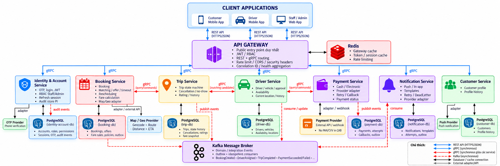
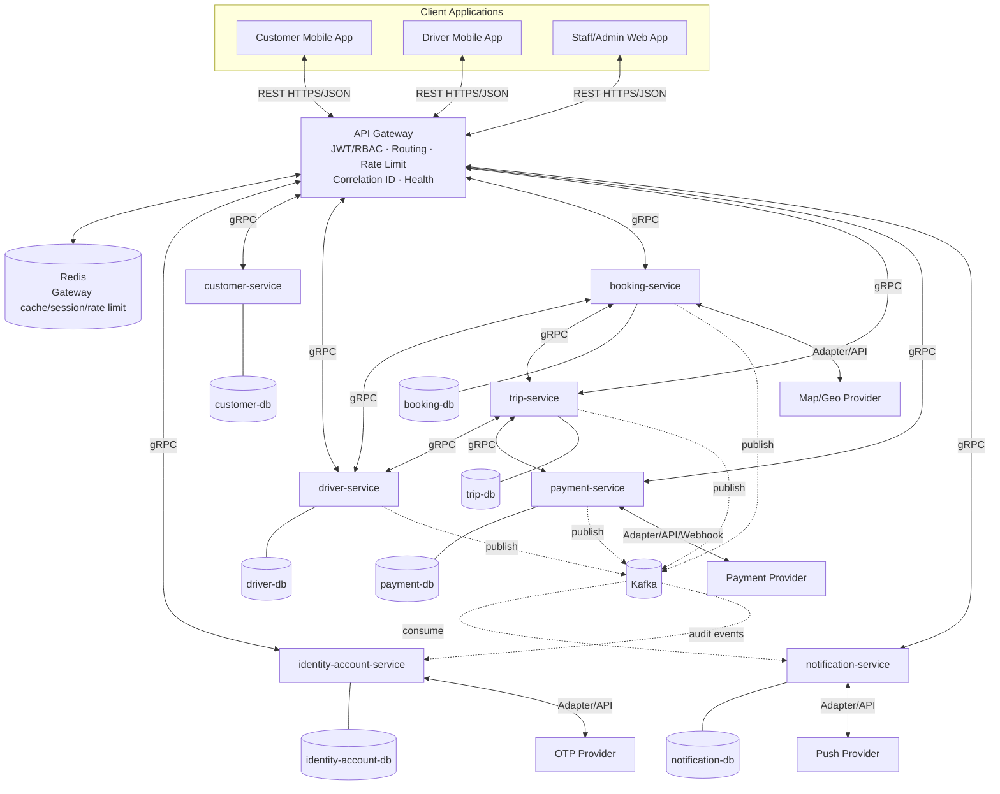
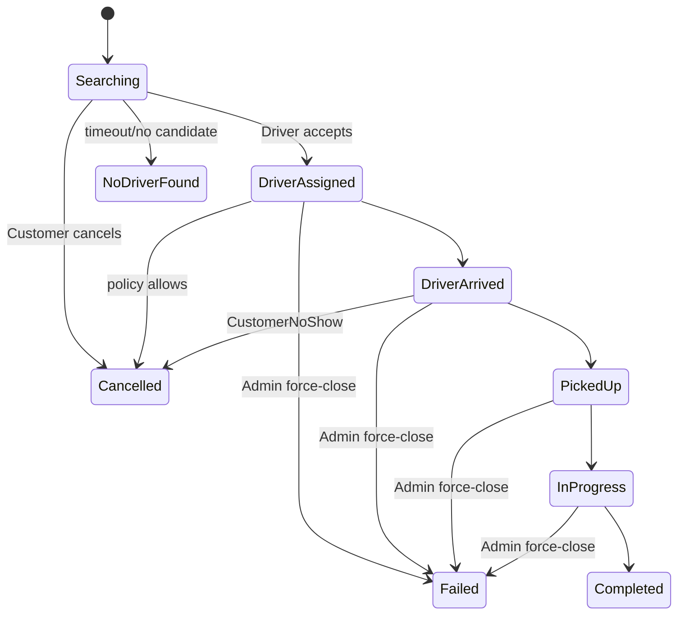
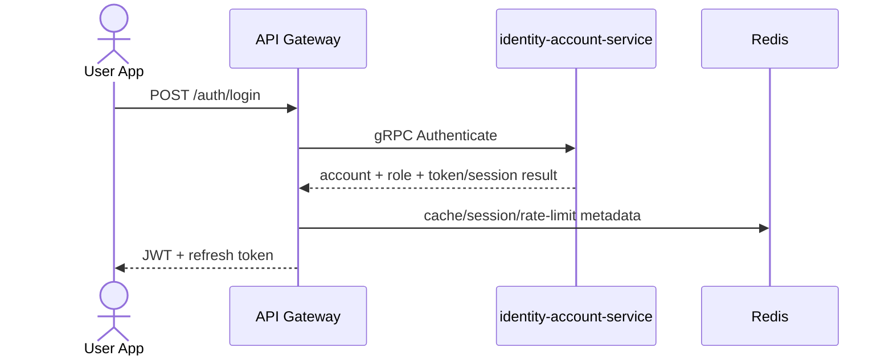
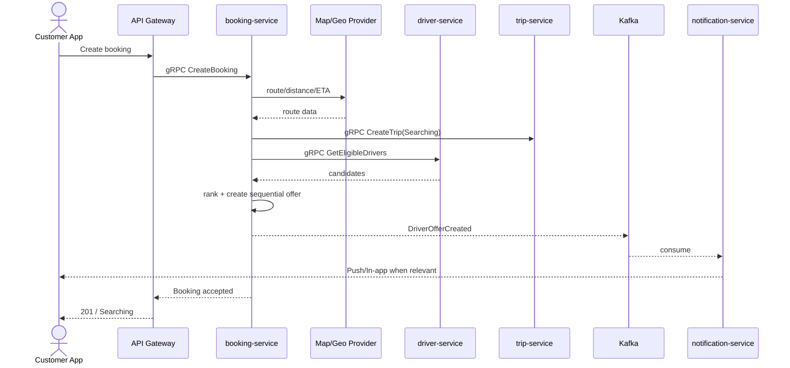
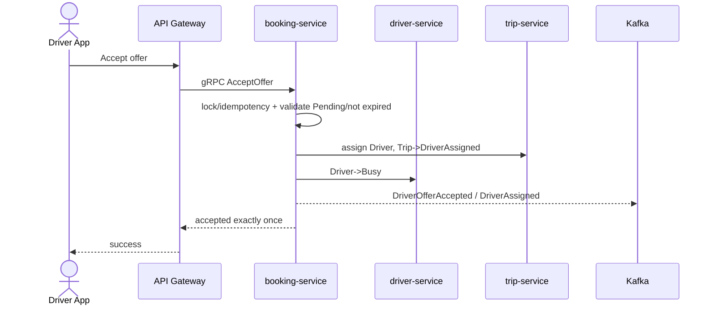
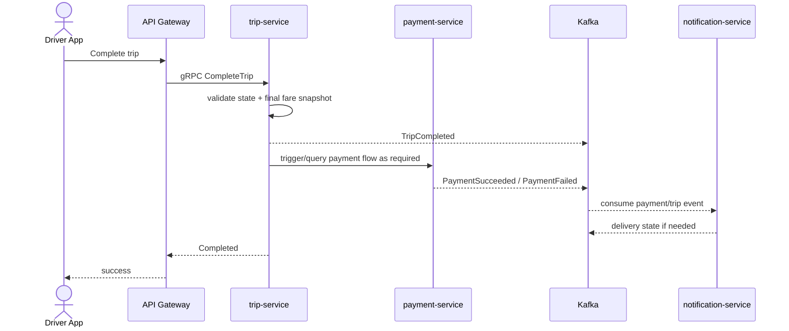

# MICROSERVICE DESIGN DOCUMENT

# CAB SYSTEM – NỀN TẢNG ĐẶT XE

| Thuộc tính         | Giá trị                                                                     |
| ------------------ | --------------------------------------------------------------------------- |
| Tài liệu           | Microservice Design                                                         |
| Hệ thống           | CAB System – Nền tảng đặt xe                                                |
| Nguồn thiết kế     | `srs_baseline_1.0.1(1).md`                                                  |
| Baseline nghiệp vụ | SRS 1.0.1 – 2026-10-03                                                      |
| Phạm vi            | P1 – 7 tuần                                                                 |
| Kiến trúc          | Microservices + API Gateway + gRPC + Kafka                                  |
| Runtime            | Java Spring Boot                                                            |
| Triển khai P1      | Docker / Docker Compose / GitHub Actions                                    |
| Trạng thái         | Design baseline bám SRS; không tạo thêm business service ngoài 7 service P1 |

---

## 1. Mục đích tài liệu

Tài liệu này chuyển các yêu cầu trong SRS CAB System thành thiết kế microservice ở mức solution/software architecture để nhóm Development, QA và DevOps có cùng baseline triển khai.

Thiết kế tuân thủ các nguyên tắc bắt buộc của SRS:

- Đúng **7 business service P1**.
- **Database per service**; service không đọc/ghi trực tiếp database của service khác.
- Client chỉ truy cập hệ thống qua **API Gateway** bằng REST/HTTPS/JSON.
- Giao tiếp đồng bộ nội bộ dùng **gRPC**.
- Giao tiếp bất đồng bộ dùng **Kafka**, kết hợp **Transactional Outbox** và **Idempotent Consumer**.
- `booking-service` sở hữu matching, offer, timeout, redispatch và fare calculation; **không tách dispatch-service hoặc pricing-service**.
- `driver-service` sở hữu current location; **không tách location-service**.
- External providers phải nằm sau adapter.
- P1 dùng Docker Compose; **không Kubernetes**.

---

## 2. Phạm vi kiến trúc P1

### 2.1 Thành phần bắt buộc

1. API Gateway.
2. Redis cho Gateway cache/token-session/rate limiting.
3. Kafka message broker.
4. 7 Java Spring Boot business service:
   - `identity-account-service`
   - `customer-service`
   - `driver-service`
   - `booking-service`
   - `trip-service`
   - `notification-service`
   - `payment-service`
5. 7 PostgreSQL database, mỗi service sở hữu một database riêng.
6. External adapter/provider:
   - OTP Provider
   - Map / Geo Provider
   - Payment Provider
   - Push Notification Provider
7. Client:
   - Customer Mobile App
   - Driver Mobile App
   - Staff/Admin Web App

### 2.2 Ngoài phạm vi kiến trúc P1

Không tạo riêng các service sau trong P1:

- `dispatch-service`
- `pricing-service`
- `location-service`
- `reporting-service`

Reporting nâng cao là P2. P1 chỉ cần dashboard vận hành cơ bản theo SRS.

---

## 3. Sơ đồ kiến trúc tổng thể



### 3.1 Mermaid source

> Mermaid dưới đây là bản logic để có thể render lại trực tiếp trong Markdown/Mermaid Live Editor. File PNG đi kèm là bản vẽ chi tiết theo phong cách sơ đồ tham chiếu.



---

## 4. Nguyên tắc thiết kế

### 4.1 Bounded Context và ownership

Mỗi service là authority cho bounded context của mình. Dữ liệu nghiệp vụ chỉ được cập nhật bởi service sở hữu dữ liệu đó. Cross-service chỉ lưu ID logic và trao đổi qua gRPC/Kafka.

### 4.2 Database per service

- Mỗi service có PostgreSQL DB riêng.
- Không foreign key xuyên database.
- Không cross-service join.
- Không dùng shared repository/domain package làm đường tắt giữa các service.
- Nếu cần dữ liệu của service khác: gọi gRPC, nhận event hoặc duy trì projection cục bộ.

### 4.3 Đồng bộ và bất đồng bộ

- **REST HTTPS/JSON:** Client → API Gateway.
- **gRPC synchronous:** Gateway → service và service → service khi caller cần phản hồi tức thì.
- **Kafka asynchronous:** domain/integration events, notification, audit và các tác vụ không cần khóa luồng nghiệp vụ gốc.

### 4.4 Fault isolation

Lỗi `payment-service` hoặc `notification-service` không được làm dừng luồng core booking → matching → trip. Việc gửi notification và audit thông thường chạy bất đồng bộ. Các thao tác Admin nhạy cảm phải bảo đảm audit được persist/outbox trước khi báo thành công.

### 4.5 Idempotency

Bắt buộc áp dụng cho:

- Booking create.
- Driver Accept offer / assignment.
- Trip state update lặp lại.
- Payment create/retry.
- Payment callback/webhook.
- Kafka consumer.

Idempotency sử dụng `Idempotency-Key`, request fingerprint, unique constraint hoặc event `eventId` tùy use case.

---

## 5. Thiết kế API Gateway

### 5.1 Trách nhiệm

API Gateway là **public entry point duy nhất** cho toàn bộ client P1.

Gateway thực hiện:

- HTTPS termination/validation ở biên triển khai.
- Verify JWT signature và expiry.
- Route-level authorization/RBAC.
- REST/JSON → gRPC internal call.
- Chuẩn hóa HTTP status/error envelope.
- Tạo/nhận và truyền `correlationId` xuyên gRPC/Kafka.
- Rate limiting/throttling.
- Request-size/basic validation.
- CORS và security headers cho web surface.
- Aggregate health/readiness.

Gateway **không chứa** business logic của matching, fare, payment hoặc Trip state machine.

### 5.2 Public health endpoints

| Endpoint               | Ý nghĩa          | Expected                                                            |
| ---------------------- | ---------------- | ------------------------------------------------------------------- |
| `GET /health`          | Liveness/overall | `200`, `status=HEALTHY` khi Gateway sống                            |
| `GET /ready`           | Readiness        | `200` + `READY`; `503` nếu dependency nội bộ bắt buộc chưa sẵn sàng |
| `GET /health/services` | Aggregate health | Gateway + đúng 7 business service, gồm `name`, `status`, `ready`    |

### 5.3 Error envelope đề xuất

```json
{
  "code": "BOOKING_NOT_FOUND",
  "message": "Không tìm thấy booking",
  "correlationId": "uuid",
  "details": {}
}
```

`details` chỉ trả khi an toàn, không chứa secret/PII nhạy cảm/stack trace.

---

## 6. Thiết kế từng microservice

## 6.1 identity-account-service

**Ownership**

- OTP verification.
- Login/logout.
- Access/refresh token.
- JWT claims/role.
- RBAC cho Staff/Admin.
- Account lifecycle.
- P1 centralized audit store.

**Database:** `identity-account-db`

Bảng chính:

- `accounts`
- `roles`
- `permissions`
- `role_permissions`
- `refresh_sessions`
- `otp_verifications`
- `audit_events`

**External integration**

- OTP Provider qua adapter.

**Security đặc thù**

- Password hash bằng bcrypt/Argon2id.
- Refresh token revoke/rotation.
- Login/OTP endpoint phải rate limit.
- Audit append-only.

---

## 6.2 customer-service

**Ownership**

- Customer profile.
- Customer profile history.

**Database:** `customer-db`

Bảng chính:

- `customers`
- `customer_profile_history`

**Boundary rule**

Customer account/password/token không nằm trong service này; identity thuộc `identity-account-service`.

---

## 6.3 driver-service

**Ownership**

- Driver profile.
- Vehicle.
- Driver documents.
- Driver approval.
- Availability: `Offline`, `Available`, `Busy`.
- Current location.
- Driver location history.

**Database:** `driver-db`

Bảng chính:

- `drivers`
- `vehicles`
- `driver_documents`
- `driver_availability`
- `driver_current_location`
- `driver_location_history`

**Location rules**

- Driver gửi location/heartbeat mỗi **10 giây** khi `Available` hoặc `Busy`.
- Sau **30 giây** không heartbeat → `Offline`.
- Location cũ hơn 30 giây không được dùng cho matching.
- Detailed location history retention **90 ngày**.

**Boundary rule**

Không tạo `location-service` P1.

---

## 6.4 booking-service

**Ownership**

- Booking aggregate.
- Service type.
- Matching Driver.
- Driver offer.
- Timeout / expired offer.
- Redispatch.
- Matching policy.
- Fare estimate/final calculation policy.
- Map/Geo adapter.
- Transactional outbox cho event của booking/matching.

**Database:** `booking-db`

Bảng chính:

- `bookings`
- `driver_offers`
- `driver_reservations`
- `service_types`
- `fare_rules`
- `fare_calculations`
- `booking_policies`
- `outbox_events`

### Matching policy P1

| Policy                  |                  Giá trị |
| ----------------------- | -----------------------: |
| Search radius           |                     5 km |
| Max candidates mỗi vòng |                10 Driver |
| Offer timeout           |           60 giây/Driver |
| Total search time       |                 120 giây |
| Offer strategy          |               Sequential |
| Radius expansion        |                    Không |
| Primary ranking         |     Khoảng cách tăng dần |
| Tie-break               | Driver Available sớm hơn |

Không dùng rating/acceptance/cancellation rate để xếp hạng trong P1.

### Fare P1

```text
DistanceFare = DistanceKm × PricePerKm
FinalFare    = BaseFare + DistanceFare + Surcharge
```

- Không tính theo phút.
- Không minimum fare P1.
- `BaseFare`, `PricePerKm`, `Surcharge` cấu hình theo service type.
- Làm tròn 1.000 VND.
- Fare rule có version.
- Trip giữ snapshot fare rule.

**External integration:** Map/Geo Provider cho geocode/route/distance/ETA.

---

## 6.5 trip-service

**Ownership**

- Trip lifecycle.
- State transition validation.
- Cancellation/no-show.
- Trip history.
- Rating Customer → Driver.
- Fare rule snapshot gắn Trip.

**Database:** `trip-db`

Bảng chính:

- `trips`
- `trip_status_history`
- `trip_cancellations`
- `ratings`
- `trip_fare_snapshot`

### Trip state machine



P1 không cho Driver tự hủy sau khi Accept.

---

## 6.6 payment-service

**Ownership**

- Payment aggregate.
- Cash confirmation.
- Electronic payment initiation.
- Payment Provider adapter.
- Callback/webhook validation.
- Retry/attempt tracking.
- Payment status.

**Database:** `payment-db`

Bảng chính:

- `payments`
- `payment_attempts`
- `provider_callbacks`
- `outbox_events`

**Rules**

- Payment chỉ tạo sau Trip `Completed`.
- Electronic payment retry tối đa **3 lần trong 24 giờ**.
- Không tự chuyển Electronic → Cash khi thất bại.
- Sau ngưỡng retry: giữ `Failed`, thông báo Customer, tạo luồng Staff xử lý.
- Payment fail không đổi Trip khỏi `Completed` và không chặn Customer đặt Trip mới.
- Không lưu PAN/CVV.
- Webhook phải verify signature + idempotency/replay + amount/reference.
- Retention Payment/Transaction: **5 năm**.

---

## 6.7 notification-service

**Ownership**

- In-app notification.
- Push notification.
- Notification template.
- Delivery attempt.
- Retry/DeadLetter.
- Push Provider adapter.

**Database:** `notification-db`

Bảng chính:

- `notifications`
- `notification_templates`
- `notification_attempts`
- `outbox_events`

**Rules**

- P1: Push + In-app.
- Consume Kafka theo `eventId` idempotent.
- Retry tối đa **3 lần**.
- Hết retry → `DeadLetter` + cảnh báo Admin.
- Lỗi notification không rollback Booking/Trip/Payment.
- Retention notification: **90 ngày**.

---

## 7. Ma trận data ownership

| Service                  | Database            | Dữ liệu authority                                                 |
| ------------------------ | ------------------- | ----------------------------------------------------------------- |
| identity-account-service | identity-account-db | Account, role, permission, session, OTP, audit                    |
| customer-service         | customer-db         | Customer profile                                                  |
| driver-service           | driver-db           | Driver, vehicle, approval, availability, current/history location |
| booking-service          | booking-db          | Booking, offer, reservation, service type, fare/policy            |
| trip-service             | trip-db             | Trip lifecycle, cancellation, rating, fare snapshot               |
| payment-service          | payment-db          | Payment, attempts, callbacks                                      |
| notification-service     | notification-db     | Notification, template, delivery attempts                         |

Cross-service reference như `customerId`, `driverId`, `bookingId`, `tripId` là ID logic, không phải database foreign key xuyên service.

---

## 8. Giao tiếp đồng bộ gRPC

Các interface dưới đây là **design-level contract**, tên RPC cuối cùng được định nghĩa trong `contracts/proto/`.

| Caller          | Callee                   | Mục đích                                                                                                   |
| --------------- | ------------------------ | ---------------------------------------------------------------------------------------------------------- |
| API Gateway     | 7 services               | Chuyển public REST request thành internal gRPC                                                             |
| booking-service | driver-service           | Lấy Driver hợp lệ/nearby/availability/current location cho matching                                        |
| booking-service | trip-service             | Tạo/đồng bộ Trip liên quan Booking                                                                         |
| trip-service    | driver-service           | Kiểm tra Driver được gán, cập nhật availability theo lifecycle                                             |
| trip-service    | payment-service          | Tra cứu/trigger luồng payment khi cần phản hồi đồng bộ                                                     |
| service bất kỳ  | identity-account-service | Chỉ khi cần contract account/authorization có phản hồi tức thì; không dùng để bypass Gateway authorization |

### 8.1 gRPC design rules

- Deadline/timeout bắt buộc.
- Không retry mù các mutation không idempotent.
- Truyền `correlationId` trong metadata.
- Không truyền token/PII dư thừa.
- Mapping lỗi gRPC ↔ public HTTP thống nhất ở Gateway.
- Proto version phải backward-compatible trong baseline.

---

## 9. Kafka event-driven design

### 9.1 Event envelope

```json
{
  "eventId": "uuid",
  "eventType": "TripCompleted",
  "eventVersion": "1.0",
  "occurredAt": "2026-10-03T08:15:30.123Z",
  "producer": "trip-service",
  "correlationId": "uuid",
  "aggregateId": "tripId",
  "payload": {}
}
```

### 9.2 Event catalog P1 chính

- `BookingCreated`
- `DriverOfferCreated`
- `DriverOfferAccepted`
- `DriverOfferRejected`
- `DriverOfferExpired`
- `DriverAssigned`
- `DriverArrived`
- `TripPickedUp`
- `TripInProgress`
- `TripCompleted`
- `TripCancelled`
- `PaymentSucceeded`
- `PaymentFailed`
- `NotificationRequested`

### 9.3 Producer ownership

| Event group                    | Producer authority                                                 |
| ------------------------------ | ------------------------------------------------------------------ |
| Booking / Offer                | booking-service                                                    |
| Trip state                     | trip-service                                                       |
| Driver domain state            | driver-service                                                     |
| Payment                        | payment-service                                                    |
| Notification delivery          | notification-service khi cần phát delivery status                  |
| Audit domain/integration event | các service nghiệp vụ; lưu tập trung P1 ở identity-account-service |

### 9.4 Outbox pattern

Mỗi producer có nhu cầu publish event phải ghi domain change + outbox cùng một DB transaction. Publisher đọc `outbox_events`, publish Kafka và đánh dấu trạng thái. Cơ chế này tránh trường hợp DB commit thành công nhưng event bị mất.

### 9.5 Consumer idempotency

Consumer phải deduplicate bằng `eventId` hoặc inbox/processed-event store. Duplicate event không được tạo thêm notification/payment/assignment ngoài ý muốn.

---

## 10. Luồng nghiệp vụ quan trọng

## 10.1 Đăng nhập



## 10.2 Tạo Booking và tìm Driver



## 10.3 Driver Accept



## 10.4 Trip Completed → Payment



---

## 11. Redis design

Redis P1 thuộc phạm vi API Gateway, dùng cho:

- Token/session cache khi cần.
- Rate limiting counters.
- Gateway cache phù hợp.

Không dùng Redis làm source of truth của Booking/Trip/Payment. Dữ liệu nghiệp vụ authority vẫn nằm trong PostgreSQL của service tương ứng.

---

## 12. External Adapter design

| Adapter         | Service sở hữu           | Contract                                                |
| --------------- | ------------------------ | ------------------------------------------------------- |
| OTP Adapter     | identity-account-service | Gửi/verify OTP theo provider P1                         |
| Map/Geo Adapter | booking-service          | Geocode, route, distance, ETA                           |
| Payment Adapter | payment-service          | Init transaction, query status, signed webhook/callback |
| Push Adapter    | notification-service     | Push notification                                       |

Mục tiêu của adapter là có thể mock/sandbox khi demo và thay provider mà không làm thay đổi domain core.

---

## 13. Security architecture

### 13.1 Authentication / authorization

- JWT + refresh token.
- RBAC server-side, deny-by-default.
- Gateway kiểm tra route-level authorization.
- Service vẫn phải kiểm tra object/resource-level authorization.
- Customer chỉ truy cập tài nguyên của mình.
- Driver chỉ thao tác offer/Trip được gán.

### 13.2 Data protection

- Client → Gateway và external connections dùng HTTPS/TLS.
- Password: bcrypt/Argon2id + salt.
- Sensitive reversible PII/identity-document fields: AES-256-GCM hoặc tương đương, key ngoài DB, có `keyId`/rotation.
- Không lưu PAN/CVV.
- Mask PII khi không cần thiết.
- Không log password/token/card data hoặc PII dư thừa.

### 13.3 Application security

- ORM/prepared statement/parameter binding; cấm nối SQL từ input.
- Validation + output encoding chống XSS.
- JWT algorithm allowlist và verify signature trước khi trust claim.
- Rate limit trả `429 Too Many Requests` + `Retry-After`.
- Booking/payment callback/retry phải chống replay/idempotent.

### 13.4 Secret management

- Không hard-code secret.
- `.env` và key/certificate private không commit.
- Commit `.env.example` chỉ chứa placeholder.
- CI/CD secret lưu ở GitHub Actions Secrets hoặc cơ chế tương đương.
- DB credential riêng với quyền tối thiểu theo service.

---

## 14. Reliability và resilience

### 14.1 Timeout

- REST public: Gateway có request timeout phù hợp NFR p95.
- gRPC: mỗi call có deadline.
- External provider: timeout riêng và không chặn vô thời hạn.

### 14.2 Retry

Chỉ retry lỗi transient và chỉ khi operation an toàn/idempotent.

- Notification: tối đa 3 lần.
- Electronic payment: Customer retry tối đa 3 lần/24 giờ theo business rule; không phải network retry vô hạn.
- Kafka consumer: retry bounded; poison message vào dead-letter strategy.

### 14.3 Circuit breaker

Khuyến nghị áp dụng cho Map/Geo, Payment và Push Provider để lỗi provider không lan sang toàn hệ thống. Đây là chi tiết triển khai phục vụ NFR fault isolation; không thay đổi business rule của SRS.

### 14.4 Concurrency control

Các điểm phải chống race condition:

- Customer cancel đồng thời Driver Accept.
- Hai Accept đồng thời cho cùng Trip.
- Payment callback trùng/replay.
- Trip state update lặp hoặc sai thứ tự.

Có thể dùng optimistic locking/version, unique constraint và atomic compare-and-set ở DB service sở hữu aggregate.

---

## 15. Observability

### 15.1 Correlation

Một `correlationId` phải truyền xuyên:

```text
REST request → API Gateway → gRPC → service logs → Kafka event → consumer logs
```

### 15.2 Logging

Log structured JSON tối thiểu:

- timestamp
- service
- level
- correlationId
- actor/accountId nếu hợp lệ và không lộ PII
- operation
- result/status
- latency

Không log secret/token/password/PAN/CVV.

### 15.3 Metrics đề xuất

- HTTP/gRPC request count, latency, error rate.
- Kafka consumer lag.
- Booking created / NoDriverFound rate.
- Offer accept/reject/expired rate.
- Trip state transition errors.
- Payment success/failure rate.
- Notification success/retry/dead-letter.
- Driver online count.

### 15.4 Health/readiness

Mỗi service expose private health/readiness. Docker Compose dùng health dependency. Gateway chỉ route vào service ready.

---

## 16. Non-functional design targets

| ID     | Baseline P1                                             | Design implication                                               |
| ------ | ------------------------------------------------------- | ---------------------------------------------------------------- |
| NFR-01 | Availability 99,5%                                      | Health/readiness, fault isolation, bounded retry                 |
| NFR-02 | p95 API ≤ 2 giây                                        | Gateway timeout, gRPC deadline, DB index/cache hợp lý            |
| NFR-03 | 1.000 Driver online, 500 Trip đồng thời, 100 req/s peak | Stateless service instance, efficient location writes, load test |
| NFR-04 | Payment/Notification fail không dừng core               | Kafka async, adapter isolation                                   |
| NFR-05 | Scale độc lập 7 service                                 | Database per service, no shared business state                   |
| NFR-06 | Build/deploy độc lập; backward compatible               | Dockerfile/service, OpenAPI/proto versioning                     |
| NFR-07 | RPO ≤ 15 phút, RTO ≤ 60 phút                            | PostgreSQL backup/restore runbook                                |
| NFR-08 | Performance test tuần 6                                 | k6/JMeter/Gatling hoặc tương đương                               |
| NFR-09 | Retention theo loại dữ liệu                             | Scheduled cleanup/anonymize jobs                                 |
| NFR-10 | Location 10s, offline 30s                               | Driver heartbeat scheduler/expiry                                |
| NFR-11 | UI tiếng Việt, VND                                      | API/domain formatting contract                                   |
| NFR-12 | Trip polling 5s + push                                  | Không bắt buộc WebSocket P1                                      |

---

## 17. Deployment design P1

### 17.1 Runtime topology

```text
Docker Compose Network
├── api-gateway
├── redis
├── kafka
├── identity-account-service
├── customer-service
├── driver-service
├── booking-service
├── trip-service
├── payment-service
├── notification-service
├── identity-account-db
├── customer-db
├── driver-db
├── booking-db
├── trip-db
├── payment-db
└── notification-db
```

Business-service ports chỉ expose trong Docker network, không public trực tiếp cho client.

### 17.2 CI/CD

GitHub Actions baseline:

1. Checkout.
2. Build/test từng service.
3. Static/code quality/security checks tùy pipeline.
4. Build Docker images.
5. Start Compose integration environment.
6. Health smoke test.
7. Postman/Newman grading/integration tests.

### 17.3 Repository structure

```text
cab-system/
├─ api-gateway/
├─ services/
│  ├─ identity-account-service/
│  ├─ customer-service/
│  ├─ driver-service/
│  ├─ booking-service/
│  ├─ trip-service/
│  ├─ notification-service/
│  └─ payment-service/
├─ contracts/
│  ├─ openapi/
│  └─ proto/
├─ infra/
│  ├─ docker-compose.yml
│  └─ db-init/
├─ scripts/
│  └─ seed/
├─ postman/
├─ docs/
├─ .env.example
├─ .gitignore
└─ README.md
```

---

## 18. Database and indexing considerations

### 18.1 identity-account-db

Index đề xuất:

- unique `phone_number`/login identifier.
- refresh session token hash/session id.
- audit `(occurred_at, actor_id, event_type)`.

### 18.2 customer-db

- unique logical `account_id`.
- query theo customer id.

### 18.3 driver-db

- unique phone/account mapping.
- unique active vehicle plate theo business rule.
- `(availability_status, service_type)`.
- current location spatial indexing nếu PostgreSQL/PostGIS được dùng; nếu không dùng PostGIS thì cần chiến lược geo query được kiểm thử tải.
- location history `(driver_id, timestamp)`.

### 18.4 booking-db

- booking `(customer_id, created_at desc)`.
- offer `(booking_id, status)`.
- unique/constraint bảo đảm tối đa một Pending offer cho Trip/Booking theo strategy.
- fare rule `(service_type, effective_from, version)`.
- outbox `(status, created_at)`.

### 18.5 trip-db

- `(customer_id, created_at desc)`.
- `(driver_id, state)`.
- status history `(trip_id, occurred_at)`.
- unique rating theo `trip_id`.

### 18.6 payment-db

- unique payment business key theo Trip.
- unique provider reference/callback id khi provider hỗ trợ.
- `(trip_id, status)`.
- outbox `(status, created_at)`.

### 18.7 notification-db

- `(recipient_id, created_at desc)`.
- `(status, next_retry_at)`.
- unique consumer/event key để deduplicate khi cần.

---

## 19. Retention

| Dữ liệu                        | Retention baseline |
| ------------------------------ | -----------------: |
| Trip history                   |              5 năm |
| Payment/transaction            |              5 năm |
| Locked account relevant record |              5 năm |
| Audit                          |              1 năm |
| Driver detailed location       |            90 ngày |
| Notification                   |            90 ngày |

Hết retention phải xóa/anonymize theo batch policy; không giữ dữ liệu vô thời hạn nếu không có yêu cầu khác.

---

## 20. Architectural Decisions Record (ADR)

| ADR    | Quyết định                                                                                                      |
| ------ | --------------------------------------------------------------------------------------------------------------- |
| ADR-01 | Microservices, đúng 7 business service P1                                                                       |
| ADR-02 | PostgreSQL database per service; không direct DB access xuyên service                                           |
| ADR-03 | Client REST/HTTPS/JSON qua API Gateway                                                                          |
| ADR-04 | Internal synchronous communication dùng gRPC                                                                    |
| ADR-05 | Async dùng Kafka + outbox + idempotent consumer                                                                 |
| ADR-06 | booking-service sở hữu matching và chống double assignment                                                      |
| ADR-07 | Driver current location thuộc driver-service; Map/Geo qua adapter                                               |
| ADR-08 | Fare/matching/cancellation policy có version; Trip giữ fare snapshot                                            |
| ADR-09 | External provider sau adapter; mock/sandbox được phép P1                                                        |
| ADR-10 | Docker Compose + GitHub Actions; không Kubernetes P1                                                            |
| ADR-11 | Monorepo; OpenAPI/proto tách contract; không shared business code xuyên service                                 |
| ADR-12 | Grading/security contract bổ sung không thay đổi business baseline đã chốt                                      |
| ADR-13 | JWT dùng RS256; access token 15 phút; refresh token 7 ngày; refresh rotation mỗi lần dùng; `kid` + key rotation |
| ADR-14 | gRPC deadline theo loại RPC; Gateway giữ tổng synchronous budget < 2 giây                                       |
| ADR-15 | Kafka topic theo bounded context, 3 partitions/topic, key theo `aggregateId`, retention domain event 7 ngày     |
| ADR-16 | Kafka consumer retry 3 lần theo backoff 1s/5s/15s; sau đó đưa vào DLQ                                           |
| ADR-17 | PostgreSQL dùng HikariCP với pool size theo tải từng service                                                    |
| ADR-18 | P1/demo dùng provider qua adapter; test/demo ưu tiên provider mock deterministic để Postman chạy ổn định        |
| ADR-19 | PII mã hóa AES-256-GCM; key ngoài DB/source, có `keyId` và rotation                                             |
| ADR-20 | Circuit breaker dùng Resilience4j với ngưỡng lỗi 50%, open 30 giây                                              |
| ADR-21 | Geo query dùng PostgreSQL + PostGIS (`geography(Point,4326)` + GiST)                                            |

---

## 21. Các quyết định thiết kế đã khóa cho implementation

Các quyết định dưới đây là **technical baseline của P1**. Team implement theo đúng giá trị này để tránh phát sinh TBD trong giai đoạn code/demo. Chúng **không thay đổi business rule** đã được SRS khóa; nếu cần thay đổi phải tạo ADR mới và chứng minh không làm sai SRS/phiếu chấm.

### 21.1 JWT / Token — ADR-13

| Hạng mục              | Giá trị đã khóa                                                                              |
| --------------------- | -------------------------------------------------------------------------------------------- |
| Signing algorithm     | **RS256**                                                                                    |
| RSA key size          | **2048 bit trở lên**                                                                         |
| Key identification    | JWT header bắt buộc có `kid`                                                                 |
| Access token TTL      | **15 phút**                                                                                  |
| Refresh token TTL     | **7 ngày**                                                                                   |
| Refresh token storage | Chỉ lưu **hash** của refresh token trong `identity-account-db`                               |
| Refresh rotation      | **Rotate mỗi lần refresh**; token cũ bị revoke ngay sau khi đổi                              |
| Logout                | Revoke refresh session hiện tại                                                              |
| JWT validation        | Chỉ allowlist `RS256`; verify signature/expiry **trước khi trust `sub`, `role`, permission** |
| Signing-key rotation  | Hỗ trợ nhiều `kid`; rotate định kỳ **90 ngày** hoặc ngay khi nghi lộ khóa                    |

**Lý do:** dễ triển khai với Spring Security/JWK, tách private/public key và bảo đảm bài kiểm tra sửa payload JWT phải trả `401`.

### 21.2 gRPC timeout/deadline — ADR-14

Mọi gRPC call phải có deadline; không dùng call vô thời hạn.

| Nhóm RPC                                           |     Deadline |
| -------------------------------------------------- | -----------: |
| Health/readiness nội bộ                            |   **500 ms** |
| Read đơn giản: Customer/Driver/Trip/Payment lookup | **1.000 ms** |
| Geo candidate lookup / nearby Driver               | **1.200 ms** |
| Command ghi dữ liệu: create/update/accept/cancel   | **1.500 ms** |
| Gateway synchronous budget cho một public request  | **1.800 ms** |

Quy tắc retry:

- Chỉ retry tự động tối đa **1 lần** cho RPC **idempotent/read-only**, backoff **100 ms**.
- Không retry mù cho create booking, accept offer, payment hoặc command non-idempotent.
- Command quan trọng phải dùng idempotency key/request id để retry an toàn khi cần.
- Deadline được truyền xuyên call chain để không vượt NFR `p95 ≤ 2 giây`.

### 21.3 Kafka topic / partition / retention — ADR-15

**Naming convention**

```text
cab.<bounded-context>.events.v1
```

Topic P1:

```text
cab.booking.events.v1
cab.trip.events.v1
cab.driver.events.v1
cab.payment.events.v1
cab.notification.events.v1
cab.audit.events.v1
```

Quy tắc:

- **3 partitions/topic** cho P1.
- Message key = `aggregateId` (`bookingId`, `tripId`, `driverId`, `paymentId`...) để giữ ordering trong cùng aggregate.
- Retention domain/integration event: **7 ngày**.
- Local Docker Compose: replication factor = **1**.
- Môi trường production sau P1: replication factor khuyến nghị **3**.
- Event envelope giữ `eventId`, `eventType`, `eventVersion`, `occurredAt`, `producer`, `correlationId`, `aggregateId`, `payload`.
- Producer dùng **Transactional Outbox**; consumer idempotent theo `eventId`.

Consumer group convention:

```text
cab.<consumer-service>.v1
```

### 21.4 Kafka retry / DLQ — ADR-16

Consumer xử lý lỗi tạm thời theo chuỗi:

```text
attempt 1 -> 1s
attempt 2 -> 5s
attempt 3 -> 15s
-> DLQ
```

DLQ naming:

```text
cab.<bounded-context>.events.v1.dlq
```

- DLQ retention: **14 ngày**.
- Message DLQ phải giữ original `eventId`, payload, exception code, consumer name, attempt count, failedAt.
- Validation/schema error không retry nhiều lần; chuyển DLQ trực tiếp sau khi xác định là lỗi permanent.
- Kafka retry không thay thế rule nghiệp vụ `notification retry tối đa 3 lần`; hai cơ chế phải được tách riêng.
- Có log/metric cho consumer lag, retry count và DLQ count.

### 21.5 PostgreSQL connection pool — ADR-17

Dùng **HikariCP**.

| Service                  | `maximumPoolSize` | `minimumIdle` |
| ------------------------ | ----------------: | ------------: |
| identity-account-service |                10 |             2 |
| customer-service         |                10 |             2 |
| driver-service           |            **20** |             4 |
| booking-service          |            **15** |             3 |
| trip-service             |            **15** |             3 |
| notification-service     |                10 |             2 |
| payment-service          |                10 |             2 |

Cấu hình chung:

```text
connectionTimeout = 3000 ms
idleTimeout       = 60000 ms
maxLifetime       = 1800000 ms
```

`driver-service` có pool lớn hơn vì location/heartbeat và nearby query có tải cao; `booking-service`/`trip-service` có pool lớn hơn do luồng đặt xe và trạng thái chuyến.

### 21.6 Provider cho P1 / demo — ADR-18

Để Postman chạy lặp lại, không phụ thuộc tài khoản trả phí và không bị lỗi do external provider, P1 khóa provider theo profile:

| Adapter | `demo-test` provider                          | Quy tắc                                                                                                    |
| ------- | --------------------------------------------- | ---------------------------------------------------------------------------------------------------------- |
| Map/Geo | **MockGeoProvider** với seed tọa độ TP.HCM    | Trả route/distance/ETA deterministic; nearby Driver vẫn query từ `driver-service`/PostGIS                  |
| Payment | **MockPaymentProvider**                       | Hỗ trợ success, reject, timeout, duplicate callback, invalid signature, wrong amount                       |
| OTP     | **MockOtpProvider**                           | OTP demo cố định `123456`, TTL **5 phút**, tối đa **5 lần nhập sai**; **không trả OTP trong API response** |
| Push    | **MockPushProvider** + In-app notification DB | Ghi delivery attempt/status để Postman/QA xác minh                                                         |

Nguyên tắc:

- Chỉ bật fixed OTP/provider mock trong profile `demo-test`; không dùng cấu hình này cho production.
- Mọi provider đều đứng sau interface/adapter để có thể thay bằng VNPay/Stripe, SMS OTP provider, FCM hoặc Map provider mà không đổi core domain.
- Payment callback của mock provider ký bằng **HMAC-SHA256**, có `timestamp`, `providerReference`, `amount`, `status`.
- Payment callback phải verify signature + amount/reference + chống replay/idempotency trước khi cập nhật trạng thái.
- Mock provider là lựa chọn có chủ đích cho bài demo, phù hợp baseline SRS cho phép mock/sandbox.

### 21.7 Encryption key / secret strategy — ADR-19

**Data encryption**

- Password: **Argon2id** one-way hash; không dùng AES để lưu password.
- PII/identity-document cần decrypt: **AES-256-GCM**.
- IV/nonce: random **12 bytes** cho mỗi lần encrypt.
- Authentication tag: **128 bit**.
- Ciphertext lưu dạng Base64 cùng `keyId`, IV và tag.

**Key management P1**

```text
CAB_PII_KEY_V1=<base64-256-bit-key>
CAB_PII_ACTIVE_KEY_ID=v1
```

- Key chỉ được inject qua runtime environment / GitHub Actions Secret.
- `.env.example` chỉ có placeholder; `.env` thật bị `.gitignore`.
- Không lưu encryption key trong PostgreSQL, source code, Docker image hoặc log.
- Rotation: thêm `CAB_PII_KEY_V2`, chuyển active key sang `v2`; dữ liệu cũ vẫn decrypt bằng `keyId=v1`, sau đó re-encrypt batch.
- Trường cần lookup/unique như SĐT dùng normalized HMAC/hash index riêng nếu cần; không decrypt toàn bảng để tìm kiếm.

Thiết kế này phải cho phép kiểm tra trực tiếp DB và **không thấy plaintext sensitive data**.

### 21.8 Circuit breaker — ADR-20

Dùng **Resilience4j** cho external adapter và synchronous dependency có nguy cơ lỗi dây chuyền.

Cấu hình baseline:

```text
slidingWindowType          = COUNT_BASED
slidingWindowSize          = 20
minimumNumberOfCalls       = 10
failureRateThreshold       = 50%
waitDurationInOpenState    = 30s
permittedCallsInHalfOpen   = 3
```

Timeout theo provider:

| Provider           | Timeout |
| ------------------ | ------: |
| Map/Geo            |  2 giây |
| OTP                |  2 giây |
| Push               |  2 giây |
| Payment init/query |  3 giây |

- Không generic-retry payment non-idempotent.
- Notification/provider failure không rollback Booking/Trip/Payment core.
- Khi circuit mở, trả lỗi/fallback theo contract và ghi metric/log.

### 21.9 Geo query — ADR-21

Chọn **PostgreSQL + PostGIS** trong `driver-db`.

Schema đề xuất:

```sql
current_location geography(Point, 4326)
```

Index:

```sql
CREATE INDEX idx_driver_current_location_gist
ON driver_current_location
USING GIST (current_location);
```

Nearby query dùng:

- `ST_DWithin(..., radiusMeters)` để lọc bán kính.
- `ST_Distance(...)` để sắp xếp gần → xa.
- Filter thêm:
  - Driver account `Active/Approved`.
  - Availability `Available`.
  - Đúng service type.
  - Location age `<= 30 giây`.

Hai bán kính khác nhau phải được giữ đúng mục đích:

- **1 km**: endpoint grading `GET /drivers/nearby?...radiusKm=1...`.
- **5 km**: matching business policy của booking-service.

### 21.10 Các giá trị grading đã có trong SRS — giữ nguyên, không override

Các quyết định kỹ thuật trên **không được thay đổi** các baseline sau:

- `/health`, `/ready`, `/health/services` phải chạy qua Gateway.
- Mọi public request đi qua API Gateway.
- Driver nearby phải hỗ trợ `radiusKm=1`, `limit`, `page`.
- Driver self-registration phải có OTP trước khi tạo hồ sơ `Pending`.
- Payment online callback phải cập nhật đúng trạng thái và chống callback/replay trùng.
- JWT bị sửa payload/signature phải trả `401`.
- Customer gọi API không có quyền phải trả `403`.
- `POST /bookings`: **10 req/s/account, burst 20, 100 req/s/route**; khi spam lớn phải trả `429` + `Retry-After`.
- Booking/payment create/callback phải hỗ trợ idempotency để duplicate request không tạo booking/transaction lần hai.

### 21.11 Mapping nhanh sang `phieucham(2).md`

| Quyết định                          | Tiêu chí hỗ trợ trực tiếp |
| ----------------------------------- | ------------------------- |
| ADR-13 JWT RS256 + verify signature | 10, 27, 28                |
| ADR-14 gRPC deadline                | 4, 6, 15–19               |
| ADR-15/16 Kafka + retry/DLQ         | 7, 15, 16, 18, 19         |
| ADR-17 DB pool                      | 5, 6, 13, 15–19, 29       |
| ADR-18 deterministic provider       | 15, 18, 19, 21, 22        |
| ADR-19 AES-256-GCM + key management | 24                        |
| ADR-20 circuit breaker              | 6, 15, 19, 29             |
| ADR-21 PostGIS                      | 13, 15                    |
| Idempotency/payment callback        | 19, 30                    |

---

## 22. Checklist kiến trúc trước khi code

- [ ] Có đúng 7 business service P1.
- [ ] Mỗi service có DB riêng.
- [ ] Không service nào đọc DB của service khác.
- [ ] Client chỉ vào qua API Gateway.
- [ ] REST public, gRPC internal, Kafka async.
- [ ] Redis chỉ phục vụ Gateway cache/session/rate-limit theo baseline.
- [ ] booking-service sở hữu matching + fare; không tạo dispatch/pricing service.
- [ ] driver-service sở hữu location; không tạo location service.
- [ ] Outbox cho producer quan trọng.
- [ ] Idempotency cho booking/payment/assignment/callback/Kafka consumer.
- [ ] External providers qua adapter.
- [ ] Health/readiness đủ `/health`, `/ready`, `/health/services`.
- [ ] JWT/RBAC/object-level authorization được test.
- [ ] Không lưu PAN/CVV.
- [ ] Sensitive PII encryption at rest.
- [ ] Postman collection có smoke/integration/security evidence.
- [ ] JWT RS256 + access 15m + refresh 7d + refresh rotation đã cấu hình.
- [ ] Kafka topics/partitions/retention + retry/DLQ đúng ADR-15/16.
- [ ] HikariCP pool size đúng ADR-17.
- [ ] Profile `demo-test` dùng provider mock deterministic theo ADR-18.
- [ ] AES-256-GCM key lấy từ secret/env, không nằm trong DB/source.
- [ ] Resilience4j circuit breaker đúng ADR-20.
- [ ] PostGIS + GiST index hỗ trợ nearby 1km và matching 5km.
- [ ] Docker Compose dựng được Gateway + Redis + Kafka + 7 services + 7 DB.
- [ ] GitHub Actions build/test được toàn bộ P1.

---

## 23. Kết luận

Kiến trúc P1 của CAB System được tổ chức thành 7 bounded contexts độc lập sau API Gateway, sử dụng gRPC cho synchronous request và Kafka cho asynchronous event. PostgreSQL database per service bảo đảm ownership rõ ràng; Redis chỉ hỗ trợ Gateway; external systems được cô lập bằng adapter. Thiết kế ưu tiên khả năng triển khai trong 7 tuần nhưng vẫn giữ các đặc tính cần thiết của SRS: fault isolation, independent scaling, idempotency, audit, security và khả năng mở rộng về sau.
